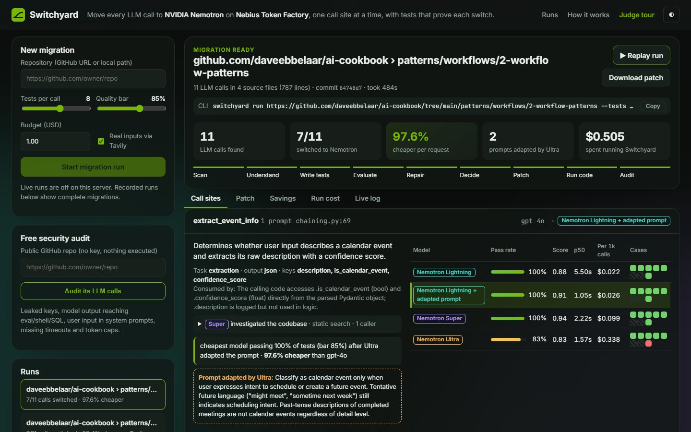

# Switchyard

[](https://github.com/ayushagarwalhere/switchyard/actions/workflows/ci.yml)  

**Move every LLM call in your app to NVIDIA Nemotron on Nebius Token Factory, one call site at a time, with tests that prove each switch.**



| On a real repo ([ai-cookbook](https://github.com/daveebbelaar/ai-cookbook/tree/main/patterns/workflows/2-workflow-patterns), 11 LLM calls) | |
|---|---|
| Calls switched to Nemotron 3.5 Lightning | **7 of 11** (a second run, with Tavily inputs, also switched 7) |
| Cheaper per request on those calls | **97.6%** (about $699.89 → $16.80 a month at 100k requests per call) |
| Cost of the whole study on Token Factory | **$0.50** (791 Nemotron calls, 8 minutes) |
| Calls it refused to switch | **4** long-form writing calls, where no cheaper model reached the bar |

**Judges:** the [5-minute guide](docs/JUDGES.md) shows where to look. To browse both recorded runs with no key: `pipx install git+https://github.com/ayushagarwalhere/switchyard && switchyard serve`, then press **Judge tour**.

Most production apps send every request to one frontier model. Many of those calls are routing, classification, extraction or short rewrites that a smaller open model handles just as well, at a fraction of the price. Nobody switches because nobody knows *which* calls are safe to move.

Switchyard answers that per call site. Point it at a repository and it:

1. **Scans** the code (static analysis, nothing is executed) for every LLM call. In Python: OpenAI and Anthropic SDK (`chat.completions`, `responses.create/parse`, `beta…parse`, `messages.create`), LiteLLM, and LangChain. In JavaScript/TypeScript: the OpenAI and Anthropic SDKs and the Vercel AI SDK (`generateText`, `streamText`, `generateObject`). It also recovers each call's prompt template, parameters and output schema.
2. **Investigates** each call like an engineer: a Nemotron agent with read-only tools (search, read file) finds who calls it, with what real inputs, and which fields of the answer drive the app's logic.
3. **Understands** each call: what task it does, what inputs look like, and how the app parses the answer.
4. **Writes tests**: typical and tricky cases with ideal reference answers, seeded with the real inputs found in the code. **Tavily** supplies real-world material where the task needs it.
5. **Evaluates** every Nemotron tier on every case: hard checks in code (valid JSON, schema match, correct labels and fields) plus a Nemotron grader. With an `OPENAI_API_KEY`, the app's **original model answers the same tests** for a head-to-head.
6. **Repairs**: if a cheaper model *nearly* passes, Nemotron Ultra adapts the prompt and the cheaper model is re-tested.
7. **Patches** the code: each call moves to the cheapest model that clears the quality bar, calls that fail stay on the original model, and every changed file is re-parsed and compiled.
8. **Runs the patched code**: each switched function is called once, for real, against Token Factory, and every HTTP request is recorded. When a function needs more than strings (say, a Pydantic object), Nemotron writes the call, runs it, and fixes it from the traceback.
9. **Audits** it: leaked keys, model output reaching `eval`/shell/SQL, user input in system prompts, missing timeouts and token caps. Then it attacks each switched prompt on its new Nemotron model with injection, prompt-leak and exfiltration probes, and re-tests the suggested fix.

**Use it the way you work:** a CLI (`switchyard run` in your app's folder), your coding agent (agent skills for Claude Code/Codex/Cursor, or the MCP server), GitHub Actions (migrate-and-open-a-PR, a nightly check, an audit in the Security tab), Python (`switchyard.migrate(".")`), or the web app, which includes a free audit of any public GitHub repo. New to it? `switchyard demo` creates a sample app to try everything on.

> Results from a recorded run are in [Results](#results).

## How Switchyard uses NVIDIA Nemotron and Nebius Token Factory

Switchyard runs entirely on Nemotron models served by Token Factory (OpenAI-compatible API). It also practises what it preaches: each internal job goes to the model that fits it.

| Job | Model | Why |
|---|---|---|
| Investigate the codebase (tool calls: search, read file) | **Nemotron 3 Super** (`nvidia/nemotron-3-super-120b-a12b`) | agentic, many small steps |
| Understand a call site | **Nemotron 3 Super** | fast, strong at reading code, structured JSON out |
| Write tests and reference answers | **Nemotron 3 Ultra** (`nvidia/Nemotron-3-Ultra-550b-a55b`), reasoning on | reference quality decides everything downstream |
| Grade candidate outputs | **Nemotron 3 Super** | many short calls, needs consistency more than depth |
| Adapt prompts for cheaper models | **Nemotron 3 Ultra**, reasoning on | rare, high-leverage |
| Write and fix calls into the patched code | **Nemotron 3 Super** | short code, retried from tracebacks |
| Candidates being tested | **Lightning** (`nvidia/Nemotron-3_5-Lightning`), **Super**, **Ultra** | the migration targets, cheapest first |

The "Run cost" tab shows exactly what each job spent.

The migrated app talks to Token Factory through its existing SDK: Switchyard only changes the client's `base_url` / `api_key` and the `model` of each call (behind an env var, so rollback is one line). If some calls stay on the original provider, their client is untouched and migrated calls get a dedicated Token Factory client.

## Other tools

- **Tavily**: finds real-world inputs (articles, tickets, product pages) so tests aren't only synthetic.
- **LangSmith** (optional): set `LANGSMITH_API_KEY` and every model call Switchyard makes is traced.
- **OpenAI** (optional): set `OPENAI_API_KEY` and the app's original model runs on the same tests as a baseline (billed by OpenAI, tracked separately from Token Factory spend).

## Quick start

Three commands, run from your app's folder:

```bash
pipx install git+https://github.com/ayushagarwalhere/switchyard    # or: uv tool install git+https://...
switchyard setup      # paste a Token Factory key once (tokenfactory.nebius.com); checked, saved to ~/.switchyard/.env
switchyard run        # finds every LLM call, tests it on Nemotron, writes the patch, offers to apply it
```

`switchyard run` shows what it found and what it will cost before spending anything:

```
Found 3 LLM call(s) in 1 source files:
  app.py:11    triage                       gpt-4o-mini
  app.py:21    extract_invoice              gpt-4o
  app.py:29    summarize                    pick_model()

Testing them on Nemotron costs about $0.23 on Token Factory (8 tests per call; hard cap $2.00, set with --budget).
Start? [Y/n]
...                         (live progress: tests, scores, decisions per call)
Apply the patch on a new branch of your checkout? [Y/n]
```

Answer yes and you get a `switchyard/nemotron-<run>` branch with the patch, `.env.switchyard.example` (the env vars the patched code reads), `.switchyard/run.json` (the saved tests) and a CI workflow that re-runs them. Nothing is committed. Review with `git diff`.

| You want to | Run |
|---|---|
| Try it without your own app (sample Python or Next.js app in its own repo) | `switchyard demo` / `switchyard demo --js` |
| See which calls Switchyard would test and the cost, free, no key | `switchyard run --dry-run` |
| Skip the questions (scripts) | `switchyard run --yes --apply` |
| Get a pull request with the evidence as its description (needs `gh`) | `switchyard run --pr`, or later `switchyard pr` |
| Apply the most recent run later | `switchyard apply` |
| Only test part of a monorepo | `switchyard run services/support` or `--include "app/**" --exclude "tests/**"` |
| Try it on someone else's repo | `switchyard run https://github.com/owner/repo` (GitHub folder links work: `.../tree/main/some/dir`) |
| Re-test the switched calls, e.g. after a prompt edit | `switchyard check` |
| Audit every LLM call for security problems (free) | `switchyard audit` |
| Add GitHub workflows (audit on PRs, check after a migration) | `switchyard ci` |
| See what a run did | `switchyard show` |
| Browse runs in the web app | `switchyard serve` |

Keys can also come from your project's `.env` or the environment (`NEBIUS_API_KEY`; optional `TAVILY_API_KEY`, `OPENAI_API_KEY`). A project's `.env` wins over the saved key. If `OPENAI_API_KEY` is set, the app's current model answers the same tests as a baseline; turn that off with `SWITCHYARD_BASELINE=0`. Tavily makes one search per call site, at most 12 per run (`SWITCHYARD_TAVILY_MAX`), and caches results in `~/.switchyard/cache`, so re-running the same repo costs no Tavily requests. With `LANGSMITH_API_KEY` (or `LANGCHAIN_API_KEY`) set, LangSmith traces the agent steps (investigate, analyze, write tests, repair), at most 150 traces per run; the hundreds of test and grading calls are not traced unless `SWITCHYARD_TRACE=all`.

### In your coding agent (Claude Code, Codex, Cursor, ...)

Switchyard ships as agent skills, so you can just ask your coding agent to *"move my LLM calls to Nemotron"* or *"check my AI app before I ship"*:

```bash
npx skills add ayushagarwalhere/switchyard
```

| Skill | What your agent does with it |
|---|---|
| [`switchyard`](skills/switchyard/SKILL.md) | free dry run → shows you the cost → runs only after you say yes → reports per call → applies the patch on a branch |
| [`switchyard-audit`](skills/switchyard-audit/SKILL.md) | finds leaked keys, model output reaching `eval`/shell/SQL, prompt-injection exposure, missing timeouts and token caps, then fixes what you pick |

**MCP clients** (Cursor, Claude Desktop, Windsurf, VS Code): install with the MCP extra and add the server:

```bash
pipx install "switchyard[mcp] @ git+https://github.com/ayushagarwalhere/switchyard@v0.3.1"
```
```json
{"mcpServers": {"switchyard": {"command": "switchyard", "args": ["mcp"]}}}
```

Tools: `scan_llm_calls` and `audit_llm_calls` (free), `start_migration` → `migration_status` → `migration_results`, and `apply_migration`. `start_migration` won't run without a `max_spend_usd` the agent has to get from you.

The skills never handle your API key (you type it into `switchyard setup` yourself), never spend without a yes, and never commit or push unless asked. Every push runs NVIDIA's [SkillSpector](https://github.com/NVIDIA/skillspector) on them in CI.

### Is it safe to ship? `switchyard audit`

```bash
switchyard audit                 # free, no key: static checks on every LLM call
switchyard audit --probes        # + attack each prompt on Nemotron and verify a fix (a few cents)
switchyard audit --format sarif --out audit.sarif   # GitHub code scanning
```

| Rule | Finds |
|---|---|
| AU1 | API keys hard-coded in source (shown masked) |
| AU2 | model output that reaches `eval`/`exec`, a shell or a SQL query |
| AU3 | variables inside the system prompt |
| AU4 / AU5 | no `max_tokens` / no client timeout |
| AU6 | `json.loads` on model output with no error handling |
| PR1 / PR2 / PR3 | probes: the model followed an injected instruction, leaked its system prompt, or emitted an exfiltration link |

The probes follow [garak](https://github.com/NVIDIA/garak)'s probe-and-detector design, aimed at *your* prompt templates rather than a bare model. Switchyard knows which variables your code fills, puts each attack into each one, and checks the answer with a deterministic detector (canary string, system-prompt n-gram overlap, attacker domain). When an attack gets through, it adds an input rule in the spirit of [NeMo Guardrails](https://github.com/NVIDIA/NeMo-Guardrails) to the system prompt and re-runs the attack. The finding says whether that fix held. In CI, [examples/switchyard-audit.yml](examples/switchyard-audit.yml) puts the findings in the repository's Security tab.

### No install: GitHub Actions

Add a `NEBIUS_API_KEY` repository secret, copy [examples/switchyard-migrate.yml](examples/switchyard-migrate.yml) to `.github/workflows/`, and press **Run workflow**. Switchyard tests every call on a GitHub runner and opens a pull request with the switches that passed. (One-time setting: *Settings → Actions → General → Allow GitHub Actions to create and approve pull requests*.)

The CI guard is a single step, and `switchyard apply` adds it for you:

```yaml
- uses: ayushagarwalhere/switchyard@v0.3.1
  with:
    nebius-api-key: ${{ secrets.NEBIUS_API_KEY }}
```

It re-runs the saved tests for every switched call ([examples/switchyard-check.yml](examples/switchyard-check.yml): nightly and on Python changes), re-scans the code so an edited prompt is what gets tested, fails the job if a call drops below the bar, and writes a pass-rate table to the job summary.

### From Python

```python
import switchyard

calls = switchyard.scan(".")                     # no API calls
result = switchyard.migrate(".", budget=1.0)     # full run; returns the run record
print(result.summary, result.patch_path)
result.apply()                                   # new branch in your checkout
```

### Hacking on Switchyard

```bash
git clone https://github.com/ayushagarwalhere/switchyard && cd switchyard
python -m venv .venv && . .venv/bin/activate      # Windows: .venv\Scripts\activate
pip install -e ".[dev,tracing]" && pytest
switchyard models                                  # check access and model ids
switchyard doctor                                  # which API features each Nemotron model supports (~30s)
switchyard publish <run-id>                        # feature a finished run in the web app + fill the Results below
```

Each run is saved in `~/.switchyard/runs/<id>/` (`runs/<id>/` in a source checkout): `run.json` (every test, output, score and decision), `migration.patch`, `migration.env`, `PR.md` (the pull-request description) and the migrated copy of the code.

## More

### Use your real traffic as the reference

Synthetic tests are a good start; your original model's real answers are better. Give Switchyard recorded calls and it matches each one to the call site that produced it (by prompt template), recovers the variables, and uses the recorded answer as the reference:

```bash
switchyard traces --langsmith my-project --out traces.jsonl   # export from LangSmith
switchyard run . --traces traces.jsonl
```

Any JSONL works: `{"messages": [...], "output": "...", "model": "gpt-4o"}`, raw OpenAI request/response logs, or LangSmith LLM runs. Production cases fill the test set first; Nemotron Ultra writes the rest.

### Check the grader against people

```bash
switchyard review <run-id> --out review.tsv          # balanced sample of graded answers
# upload to Toloka (or any rating tool); raters answer OUTPUT:verdict yes/no
switchyard review <run-id> --import results.tsv      # -> "grader agrees with humans on 92% of 40 items"
```

The export uses the `INPUT:` / `GOLDEN:` column style that crowd platforms accept, and samples passes and fails equally, so agreement is measured on both.

## How decisions are made

- A model **passes a case** when the hard checks pass *and* the grader scores it 7/10 or more.
- A model **clears the bar** for a call site when its pass rate is at least the target (default 85%) *and* its mean score is within 0.05 of the best model tested, so a cheap model never wins by squeaking past a low bar. When the original model was run as a baseline, it counts toward "best": a switch has to be about as good as what the app uses today.
- The **cheapest** model that clears the bar wins. If a cheaper model came close, Ultra adapts the prompt once and that variant is re-tested.
- If nothing clears the bar, the call **stays on its original model**. Switchyard says so; it doesn't force a migration.
- A switched function is **verified** when the patched code, run for real, returns normally and its request reaches Token Factory with the chosen model. If the app's own code chokes on the new model's answer, that's reported as a failure.

## Results

<!-- results:start -->
Recorded run `20261029-142754-6b1f` on [daveebbelaar/ai-cookbook/tree/main/patterns/workflows/2-workflow-patterns](https://github.com/daveebbelaar/ai-cookbook/tree/main/patterns/workflows/2-workflow-patterns):

- **7 of 11** call sites switched (7 on Nemotron 3.5 Lightning); 4 kept on the original model.
- **97.6% cheaper** per request across the switched calls (list prices).
- **2** call site(s) only passed after Nemotron Ultra adapted the prompt.
- The whole analysis cost **$0.50** in Token Factory credits (791 model calls, 8.1 min).

| Call site | Task | Was | Now | Tests passed | Saving |
|---|---|---|---|---|---|
| `1-prompt-chaining.py:69` extract_event_info | extraction | `gpt-4o` | Nemotron 3.5 Lightning + adapted prompt | 100% | 97.6% |
| `1-prompt-chaining.py:94` parse_event_details | extraction | `gpt-4o` | Nemotron 3.5 Lightning | 100% | 97.6% |
| `1-prompt-chaining.py:117` generate_confirmation | generation | `gpt-4o` | kept | – | – |
| `2-routing.py:77` route_calendar_request | routing | `gpt-4o` | Nemotron 3.5 Lightning | 100% | 97.6% |
| `2-routing.py:100` handle_new_event | extraction | `gpt-4o` | Nemotron 3.5 Lightning | 88% | 97.6% |
| `2-routing.py:128` handle_modify_event | extraction | `gpt-4o` | Nemotron 3.5 Lightning | 88% | 97.6% |
| `3-parallizaton.py:48` validate_calendar_request | classification | `gpt-4o` | Nemotron 3.5 Lightning + adapted prompt | 100% | 97.6% |
| `3-parallizaton.py:64` check_security | classification | `gpt-4o` | Nemotron 3.5 Lightning | 100% | 97.6% |
| `4-orchestrator.py:139` get_plan | generation | `gpt-4o-mini` | kept | – | – |
| `4-orchestrator.py:171` write_section | generation | `gpt-4o-mini` | kept | – | – |
| `4-orchestrator.py:201` review_post | other | `gpt-4o-mini` | kept | – | – |

What Switchyard itself spent, by job:

| Job | Model | Calls | Cost |
|---|---|---|---|
| Write tests | Nemotron 3 Ultra | 12 | $0.1460 |
| Grade outputs | Nemotron 3 Super | 311 | $0.1249 |
| Candidate: ultra | Nemotron 3 Ultra | 87 | $0.1046 |
| Investigate the codebase | Nemotron 3 Super | 76 | $0.0471 |
| Attack prompts (security probes) | Nemotron 3.5 Lightning | 66 | $0.0251 |
| Candidate: super | Nemotron 3 Super | 87 | $0.0224 |
| Adapt prompts | Nemotron 3 Ultra | 6 | $0.0171 |
| Candidate: lightning | Nemotron 3.5 Lightning | 135 | $0.0112 |
| Understand call sites | Nemotron 3 Super | 11 | $0.0064 |
<!-- results:end -->

## Limits

- Python and JavaScript/TypeScript. In Python, OpenAI SDK, LiteLLM and LangChain `ChatOpenAI` calls are rewritten automatically. Plain Anthropic `messages.create()` calls are rewritten too: they go through a small shim that returns Anthropic-shaped responses from Token Factory. Async, streaming and tool-use Anthropic calls are tested and get a target model in the report, but you port them by hand.
- JavaScript/TypeScript (Next.js, Node, Vercel AI SDK): OpenAI SDK and AI SDK (`generateText`, `streamText`, `generateObject`, `streamObject`) calls are tested and rewritten; Anthropic SDK calls, calls inside `"use client"` components (the key must stay on the server) and calls on a client returned by a function (`getClient().chat...`) are tested and listed for a hand port. Migrated JS calls go through a separate `tokenFactory` client, so the app's own OpenAI client (embeddings, images) is untouched. JS code isn't executed, so the runtime check and the `eval`/shell data-flow rule (AU2) are Python-only; edited JS files get a syntax check (`node --check` for .js, a bracket/string balance check for .ts).
- Prompts built far from the call site are tested as a single user turn (the investigation step tells the test writer what the real inputs look like).
- Running the patched code executes the repository's definitions (imports, classes, functions; top-level demo code is skipped) in a subprocess. It's on by default locally and off on the public demo. Turn it off with `--no-exec` or `SWITCHYARD_EXEC=0`.
- Quality is measured against reference answers written by Nemotron Ultra with reasoning on, not against the original provider's outputs. If you have recorded production outputs, those make a stronger reference.

## Project layout

```
switchyard/
  scanner.py      find call sites, prompt templates, Pydantic schemas (AST only)
  investigate.py  tool-using Nemotron agent that reads the rest of the codebase
  agents.py       Nemotron steps: analyze, write tests, grade, repair prompts
  evaluate.py     run candidates, hard checks + grader, per-model summaries
  pipeline.py     orchestration, decisions, savings, Tavily, LangSmith
  rewrite.py      AST-positioned code edits, compile checks, diff
  runcheck.py     run each switched function from the patched code against Token Factory
  publish.py      feature a run in the web app, write README results
  server.py       FastAPI + server-sent events for the web app
  web/            the web app (vanilla JS + Three.js hero)
  onboard.py      `switchyard setup`: check and save keys
  audit.py        static rules + garak-style probes, SARIF output
  mcp_server.py   the same flows as MCP tools
  gitops.py       apply / pr: branch, patch, CI workflow, pull request
action.yml        GitHub Action (check / migrate / audit)
skills/           agent skills for Claude Code, Codex, Cursor
tests/          offline tests (a scripted stand-in for Token Factory)
```

## License

MIT
